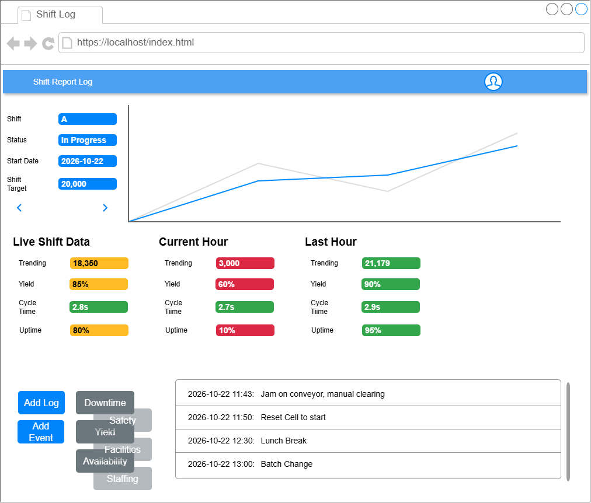

# Shift Report Log
This program is here to solve a solution on a manufacturing floor.
Currently, the performance on the manufacturing machine is tracked manually with notes on a shift handover sheet declaring what happened and when.
The issue with this approach is that the events have to be manually transposed from the paperwork into a system where the data can be monitored historically.
The data is also not controlled.  Hours go by where the machine does not make targets but there are no events raised on the paperwork.
Some issues also go into the system and are never addressed.

## System Description
This software solution is designed to take this shift production numbers automatically from an API and to raise the events automatically for production to address.
The system reads the Hours from an API which include Yield, Output, Downtime (Uptime) and Cycletime and compares it to the shift settings, also stored on an API.
The system will create an event for each hour where a target has not been met along with a status and category (type) for each event for the production staff to address.
The Events are automatically stored to the system via the API so cannot be deleted.
This allows management to track the performance of the machine and maintain accountability for machine perfomance deficits.

## Instructions.
### Automatic Events
1 - Open the Site.
>The System will automatically retrieve all previous Events and display them on a list on the screen.
The system will also display a chart at the top of the page to show the completed hours and output on the current shift.

2 - Review the Event Log.
>The Event log will be displayed on the page.
The Status of each event is displayed with a type / category.
Closed Events are displayed with a GREEN 'Closed' status but still displayed for review.
Open Events are displayed with a RED 'Open' status and require action.
Some Events are still in progress; for example, a yield issue under investigation, or cycle time experiment running faster cycle time than settings allow, these are displayed with an ORANGE 'In progress' status.
>
>Any Items created automatically by the Shift report log system will have the Event Comment `Auto Created - please update`.
These items should be addressed before close of shift with a description of what the event was and what is happening to address the event.

### Manual Events.
Some events will not be identified by the system, such as a safety item on the floor.  
To accomodate these events, the Shift Report Log system allows the manual creation of Events via the `[New Log Entry]` button.
This will bring the user to a new screen where a form is presented to allow manual creation of events.

1 - Press the `[New Log Entry]` button to bring up the page.
> This will take you to a new form to create the event.

2 - Select the Category
> Select the Category of the event you wish to create from the 'Type' dropdown.
>The options are 
>- `Dowmtime`
Machine Uptime has not been what has been expected or the system has not detected an event that has to be created.
>- `Safety`
> Record a Safety incident on the machine or surroundings`
>- `Yield`
> Rejects are high and the output will be effected.
>- `Cycletime`
> The Machine is running too slow or fast impacting another aspect of the machine.  Maybe a Yield event has been created automatically but this is a result of parts impacted by excessive motion so this is a separate issue.
> - `Output`
> Should be picked up automatically by the numbers but maybe there is another note or event to be recorded.

3 - Press `[Create Log Entry]`
> This will validate all of the inputs and if the data is acceptable, it will create the event log entry via the API on the system before returning to the main page.
If the validation fails, an error message will be displayed identifying what has failed, you can correct this before pressing `[Create Log Entry]` again.

3.2 - Press `[Cancel]`
> If you have decided to abandon the event creation, pressing `[Cancel]` will clear the form and return to the main page without creating the event on the system.

### Updating Events
Once an event has been created, it will be displayed on the `Operations event Log` on the main screen.
The Type of Event cannot be changed after creation.
#### Changing Status
1 - Click on the Status
> You can change the status of an event by clicking on the status of the event you wish to change.
A Dropdown will be presented to show you the valid options; `Open`, `Closed` and `In Progress`.

2 - Select the status you wish to assign.
> Click on the selection you wish to change the status to.

#### Changing the Event Comment.
The comments are the description of the operator of the event.
To change the comments:
1 - Click on the comment
> This will being the cursor into the edit field and you can type whatever information you wish.

2 - Type the comment
> Erase existing Data (such as "Auto Created - Please Update" ) or append new information onto the exsiting comment by typing your data into the field.

3 - Exit the field
> The comment won't be accepted while the cursor is on the field.  Press `[TAB]` on the keyboard or click outside the field to accept the entry.

#### Finalising the change
Once you have updated the event, the screen will show you your new data but the Database will not have been updated, until you click on the `[Update]` button.
This button, along with the `[Cancel]` button won't be visible unless an event has changed.
1 - Press `[Update]`
> This will take the new data on the event log and write this to the Database.
The `[Update]` and `[Cancel]` buttons are no longe displayed.

#### Cancelling the change.
If you have changed the data on the screen by accident, maybe you've clicked something in error; 
1 - Press Cancel
>pressing `[Cancel]` will re-populate the Event Log Entry with the data pulled from the Database via the API.
The `[Update]` and `[Cancel]` buttons are no longe displayed.

---
# Project report
I initially had some mad ideas of what kind of project to perform, so I used Google Gemini AI to evaluate the requirements of the assessment and to give me an Idea of what to do.
## Planning
We came up with the idea above and a plan to achieve this by project Deadlines.
*(See AI section below for chat details)*

[](https://editor.plantuml.com/uml/VPD1Qzmm48Nl1l-7WT3sj61hroc4K1AoB2qq471e3gaFKtjsLuaikHev8V--OqSESREiBsDRxtrlP8ykEA0FExGXm8rt3rHBDMZJf8jFeu010wXCdIxoR96hDBb_4tjYiW63TfOhG8Rxwxo2FNOTMGPdeorVP2j0su1cg9rnlIUvjo15QDp_QJMpC61Ds1XjARBKGLP-X3LO6isTmPVHmzWIUFSyzPOc8ZeVVFuCdlSwq3Uu8te4jzrMqtRVihA5AiOiWopl2sW6x87m4wo_AgpJ93YHV5ZTR2xbakGriTvPkDEUjbvQUztdRLP1-I4wRjFJtrxa36gMdcVP9mbfEqE1X5nIwBjnyVljzS_8pQjtVt28-S908fbnboDN45Tb2UMUZ8bkDNVd1zrgSgyn85n9GyxAI31y5erjo6kxYxpbdAUEytxOG1xhe9zqU1aqloqz2HcCva2MH1ovgpbtUP1RJDoDyotyGgERSMmZevWpLiU_rDhLVJiD_gYvSTBMFi9Evx3YFKpgVyCyZ6IQNCZ2U1B_0G00)

From this, I assembled a Wireframe for the Project and started getting to work.


I initially started as per the plan, setting up the HTML and a simple style to show the page.

I knew I needed some production Data to display on the screen so I had a look around Google and found a tool online with Retool that would serve some mock data via an API.
As we had used API Access as part if this module, i went for it and assembled a data set within Excel to automatically calculate Data for a production line.
Retool only allowed 50 rows for free so i was limited to the number of hours I could store for capture.
I was able to get the system reading the data into the browser (confirmed via the console).
I managed this via a separate test program ([API Test](https://github.com/deadlyBuzz/apiTest)) focussing solely on this task as i didn't want to marry the project to test logic so i got this working on the test program first.
I updated my test program to also store and retrieve the event log part of the site and was able to get it retrieving the data but could not get it to update the data from the updated logs back to the API.  It kept getting caught with errors on the screen for both 405 and 400 errors.
I tried post and put and neither worked, i couldn't get it working to store the data.
I engaged help with Google Gemini *(See AI section below for chat details)* to determine what I was doing wrong before finding out that Retool had removed the link on their tools page.
I was still able to GET the data but couldn't POST or PUT the data.
Gemini kept asking me to sanitise the data via the website but all my links redirected.  
From the time I started, to the time i needed to write data, Retool had retired the mock API service.
Plan B and I'm now using [MockAPI](https://mockapi.io/projects/6ae0f23bbe3bc8fead981c0c) to host the data and since I have, I've been able to GET, POST and PUT flawlessly*
(* See issues encountered below.)

I then needed to check how to display this and searched Google for a quick and easy chart library that would allow me to display the data.
I found [chart.JS](https://www.chartjs.org) online that allowed me to display a chart when i had data and got it to present the data for the relevant Data.
I built another test program ([chartjs static test](https://github.com/deadlyBuzz/chartjs_staticTest)) for managing this chart display and again got it working.

At this stage, i was well behind my plan so had to re-adjust my plan and took to a feature based approach to implementing each feature one at a time onto the bare bones program.
Some features: 
- I got the program working to display the Chart and Event log with minimal styling.
- I ended up using Google to find a [mechanism](https://developer.chrome.com/blog/a-customizable-select) for styling the `SELECT` dropdown on each status so that i could display a badge for the event status.
- I used a simpler approach for the badge style of the Event Type.
- I had some googling with MDN on Date objects to try to compare todays date to the mock data so i would pull relevant data, in the end I had to hard-code the date to the 24th of October so i would have consistent data.
- I spent some time getting the log events to update after editing the status and the notes.
- Uploaded Settings (Limits for metrics) from MockAPI
- I got the system evaluating the production hours for the current shift and creating new Events automatically, uploading them to MockAPI and refreshing the log.
    > It was at this stage I had a real issue with Asynchronous functions.

- Added form Validation
- Styles.
    > This was *much* bigger than expected and a lesson here is to give much more time to styling next time.

## Dropped Functionality
Due to timeframes and requirements, the following were initially planned but dropped due to time constraints.
- Owners
    > Was initially planning a user control and an assignment of who was logged in while events were created and assigned an owner.
    This was dropped as it wasn't required for the project and was too time intensive.
- Filters
    > I wanted to get filters and controls available so that you couldn't update a closed event.  But this limited the user experience on the site so i did not implement this, instead It stores the first close date with the event onMockAPI
    One solution for this was filters were I could filter only open events or in progress, or events for this shift etc. but again, that was too time intensive so was omitted to meet deadlines.
- Settings Controls and Summary
    > The settings (Section between Chart and Event Log in the wireframe) was supposed to show the overall data for this shift as a summary and to provide a space where an admin (Owners above) could update the settings and store to MockAPI.
    In the end, this was more work with little value so was omitted.  You can see the settings at [MockAPI](https://mockapi.io/projects/6ae0f23bbe3bc8fead981c0c) and adjust if needed.
- Previous and Historical Shift
    > The Data generated and pulled for approx' 4 days of production however, it is hard-coded to one date as I could not find the scope within the time to implement a change to display this shift, last shift.

## Issues Encountered and Lessons learned.
There were lots of issues debugged and solved to implement this project but a summary of the key ones can be described as:

### Retool
Spent a LOT of time working with retool trying to get the data to write only to find that the Service was retired while using it.
That was dissapointing and i lost a few days at it but at least I learned a lot about APIs and `FETCH` functions while debugging the issue.

### Asynchronous Functions
I initially had a forEach working with an anonymous async function to control each FETCH PUT command to MockAPI working off the assumption that the following would work:

[](https://editor.plantuml.com/uml/hPDHIyCm58NVyolkyqOhvh68JBU94vt3kHyGkzisc2OXkHdwxqrGwt3hfk9JadClvnm-oCYJS1HQnMmyPIcjq0IbGq5uQ-gf9YVHCvPbvpjg0MEX5523K0LTaZIQYNXiujQkXTCcocQ3RezHPTnKb0rZtqSGSzNxw_LqC2WWtj1znNIpRVzEBE0oIBM6c-Nzl6VXqScwZbA55FExGSgzC-NpnM8s71OmypuW2BXAMoUBrVAQvNaEAxjE9HA1YI3n93n2rBTiph9Fcomhu06zDTfZJvSFkx5fhKB2d3cau3HCZ4Ps6E0SNmX8jgcCCw5kVeQK7q3AzxNanv3oFgJyVv3oNo3bHv3-aMYgMHfDKeT4ozZKRuHw7R_H6m00)

However, I had issues with MockAPI creating multiple LogEntries with the same ID.
When a PUT is placed into my MockAPI endpoint, the ID is assigned automatically based on the number of items that are already created,
This ID is used to access each individual entry at the API but was also used in the Project to identify each logEntry (MockAPI id:**4** would create select control logStatus**4**) so by having multiple ID's, we couldnt update one of the items as a standalone and were getting duplicate ids on DOM objects in the page.
After some long conversations with Google Gemini, it turns out that my Assumption above was inaccurate.
forEach fires off a call for the anonymous function and regardless of any await commands, circles back to the next call, firing off that one too.

[](https://editor.plantuml.com/uml/hLJ1Ji904BtlLumS8SMmnyOO535Y58d8oNXOsw5iR7URxPIeN-yi810WgnXxQJllpPkthvDsArAEwY8N9wLJMQ60q7u2kHf5oOXETAaCGU9G4TxPh6_8QQo4YABplMeCFPNdG3E4QMqIqjO8nRSvi_ObdB5SjdDq1uIcrlLLCXDY5mAUco_VFZhDPWpyX6upPetjTvv56pI6r1eCUnZYEm7f0lb4pjRPREqgP4e6JCcWARaozLTN_C7WkV6j1XteBPhJnei0lhPKjsAuh7MUmktuOHWWFJcTPLoQ8l4Sprk3_kZtDdcx60rQhHW6LLKZABZspDFHP7opeBVRRPYKgS_2RyUL8lMgAlJr7JdEOoKNHJ4yObLQKs70sqgsPuioHyAbNee75W9pdhWLaFmv8FcRW6Ge8Fc_0SaZ0v870aAJxjAFMJFVAhpVn1hIflOHsz8RxR8o_qk-0000)

Each loop would start at almost the same time irregardless of delays and awaits and MockAPI would get simultaeneous requests, so was returning an ID before the database had been updated, leading to duplicate IDs.

Once I implemented the delays inside a for loop
```js
for(const hourEntry of hourEntries){
```

The updates worked perfectly.
### Bootstrap
I liked the way Bootstrap rendered pages but I hated the way that each element, thought they would be similar, would require the same class entries all the time to define the element.
I had intended on using Bootstrap so I had imported it, but I had incorrectcly placed it below my own CSS so it was interfering in many more ways than i had expected.
I simply reomved bootstrap to implement my final solution.

## AI Usage
Ai was used to Generate the Ideas for a project that could be used for the assessment
Was used to help debug the Issues with reTool and API Storage.
AI was also used to help find the issues with `forEach` and the asynchronous function calls for MockAPI.

